<p align="center">
  
</p>

<p align="center">
  
  
  
  
  
  
  <a href="./LICENSE"></a>
</p>

<p align="center">
  <a href="https://statuesque-pudding-4a326c.netlify.app/">Live demo</a>
  &nbsp;·&nbsp;
  <a href="#quick-start">Quick start</a>
  &nbsp;·&nbsp;
  <a href="#system-architecture">Architecture</a>
  &nbsp;·&nbsp;
  <a href="#uart--message-protocol">Protocol</a>
  &nbsp;·&nbsp;
  <a href="#roadmap--iot-integration">Roadmap</a>
</p>

---

## Contents

1. [Overview](#overview)
2. [Key features](#key-features)
3. [System architecture](#system-architecture)
4. [Lighting logic](#lighting-logic)
5. [Hardware](#hardware)
6. [Software and tools](#software--tools)
7. [C# admin application](#c-admin-application)
8. [Web dashboard](#web-dashboard)
9. [Feedback mobile app](#smartanci-feedback-mobile-app)
10. [UART and message protocol](#uart--message-protocol)
11. [3D models and physical mockup](#3d-models--physical-mockup)
12. [Bill of materials](#bill-of-materials)
13. [Quick start](#quick-start)
14. [Reliability and security](#reliability--security)
15. [Roadmap and IoT integration](#roadmap--iot-integration)
16. [Gallery](#gallery)
17. [License](#license)

---

## Overview

Streets are usually lit at full brightness all night, even when nobody is there. This project demonstrates a more efficient approach: a **Smart Street Lighting** server and a **Smart Traffic Light** client that react to real traffic in real time.

Four ultrasonic sensors detect vehicles along the street. An **Arduino Uno R4 WiFi** server turns that data into a moving corridor of light that follows the vehicle, hosts a live web dashboard, and sends commands over **UART** to an **Arduino Uno R3** that controls the traffic light.

| Goal | How it is achieved |
|:---|:---|
| **Safety** | Light is always present where a vehicle is. |
| **Energy saving** | Segments without traffic stay dimmed (PWM). |
| **Visibility** | Live monitoring through a web dashboard and a desktop admin app. |
| **Scalability** | Modular design that can grow into wider smart-city integration. |

---

## Key features

| Area | Description |
|:---|:---|
| **Adaptive lighting** | Cascading logic activates the segments around a detected vehicle and dims the rest. |
| **Smart traffic light** | The client unit receives commands over UART and controls signals in real time. |
| **Live web dashboard** | Hosted on the Arduino R4 WiFi: street view, detection history, UART log. |
| **C# admin application** | Sensor feed, manual control, event log, UART monitor, CSV export, admin login. |
| **Operating modes** | `AUTO`, `MANUAL` and `MAINTENANCE`. |
| **Fallback mode** | The traffic light falls back to a safe predefined cycle when communication is lost. |
| **Feedback application** | .NET MAUI mobile app for ratings and comments, delivered through Formspree. |
| **Physical mockup** | 3D-printed traffic light housing and a small-scale street model. |

---

## System architecture

<p align="center">
  
</p>

### Components

| Component | Hardware / technology | Role |
|:---|:---|:---|
| **Server** | Arduino Uno R4 WiFi | Aggregates sensor data, runs lighting logic, hosts the dashboard, communicates with the client. |
| **Client** | Arduino Uno R3 (ATmega328P) | Smart traffic light: receives commands, controls signals, reports status. |
| **Sensors** | 4 x HC-SR04 | Vehicle detection along the street. |
| **Admin system** | C# desktop application | Monitoring, logging, manual control, UART diagnostics. |
| **Web dashboard** | HTML, CSS, JavaScript | Live visualization and history, served by the R4. |
| **Feedback application** | .NET MAUI | User feedback via Formspree. |

### Communication channels

| Channel | Between | Purpose |
|:---|:---|:---|
| **WiFi (HTTP / WebSocket)** | Server and web dashboard / C# app | Real-time visualization and control (when networked). |
| **UART** | Server and traffic light client | Low-latency commands and status. |
| **Local I/O** | Sensors and LEDs, Arduinos | Trigger/echo signals and PWM dimming. |

---

## Lighting logic

The four sensors are distributed along the street. **Cascading logic** creates a moving light corridor that follows each vehicle.

<p align="center">
  
</p>

| Sensor | Position | Activates segments |
|:---:|:---|:---:|
| **HC1** | Street entry (closest to S1) | S1, S2 |
| **HC2** | Second segment | S2, S3 |
| **HC3** | Third segment | S3, S4 |
| **HC4** | Exit segment | S4 |

When HC1 detects a vehicle, the server sets S1 and S2 to active brightness. When HC2 triggers, S2 and S3 become active, and so on. The corridor travels with the traffic while the rest of the street stays dimmed.

---

## Hardware

### Main components

- **Arduino Uno R4 WiFi** (server: lighting host and web dashboard)
- **Arduino Uno R3, ATmega328P** (client: smart traffic light)
- **HC-SR04** ultrasonic sensors, 4 pcs
- **LEDs** (street lamp simulation) with **220 Ω** resistors
- **I2C multiplexer** (optional, for extending the number of sensors)
- **5 V power supply** sized for the total LED load
- Enclosures, mounting brackets and wiring

> **Note:** connect a **common ground** between the server and the client before wiring UART TX/RX.

### Schematic

<p align="center">
  
</p>

### Assembly diagram

<p align="center">
  
</p>

<p align="center"><sub>Wiring, connectors, power distribution and mounting points for the traffic light mockup.</sub></p>

---

## Software & tools

| Category | Tool / technology |
|:---|:---|
| **Firmware IDE** | Arduino IDE, Visual Studio Code (PlatformIO / Arduino extensions) |
| **Desktop app IDE** | Visual Studio |
| **PCB / schematic** | KiCad 10.0 |
| **3D / CAD** | FreeCAD, Fusion 360 (or similar) |
| **Firmware language** | C++ (server and client) |
| **Admin application** | C# (.NET, Visual Studio solution) |
| **Mobile application** | C# / .NET MAUI |
| **Dashboard** | HTML, CSS, JavaScript |
| **Real-time transport** | WebSocket / HTTP |
| **Device link** | UART (serial) |

---

## C# admin application

- Real-time sensor feed (HC1–HC4 values with timestamps)
- Manual control of lighting segments (`LED1: 1/0`, PWM brightness)
- Traffic status view and event log (detections, commands, errors)
- **UART monitor**: live serial log between server and client, send and receive raw commands
- Fault notifications and history export to **CSV**
- Basic admin authentication

<p align="center">
  
</p>

---

## Web dashboard

- Live street visualization with lamp segments and active sensors
- Detection history graph (timeline of sensor triggers)
- UART log viewer showing messages exchanged with the client
- Accessible from any device on the same network
- Manual override controls and mode selection (`AUTO` / `MANUAL` / `MAINTENANCE`)

<p align="center">
  
</p>

---

## Smartanci Feedback mobile app

A **.NET MAUI** application for collecting user feedback. Users enter their name, surname, a comment and a rating (1–5 stars). Submissions are delivered through the **Formspree** service, so no custom backend is required.

<p align="center">
  
  &nbsp;&nbsp;
  
</p>

---

## UART & message protocol

All messages are **ASCII, CSV-style and newline-terminated** (`\n`).

| Message type | Direction | Example |
|:---|:---:|:---|
| `SENSOR_UPDATE` | Server → Dashboard / C# | `SENSOR,HC1,120\n` |
| `LIGHT_CMD` | Server → Client | `LIGHT,S1,200\n` |
| `SEMAFOR_STATUS` | Client → Server | `HB,SEMAFOR,OK\n` |
| `ADMIN_CMD` | C# → Server | `SEMAFOR,MODE,AUTO\n` |

Every command expects an `ACK` or `ERR` response. The firmware implements retries and timeouts.

---

## 3D models & physical mockup

The project includes 3D models of the **traffic light housing** and a small-scale **street mockup**, prepared for 3D printing and assembly.

<p align="center">
  
  
</p>

<p align="center">
  
</p>

<p align="center"><sub>Render of the traffic light housing and mockup used for printing and assembly.</sub></p>

---

## Bill of materials

| Item | Qty | Notes |
|:---|:---:|:---|
| Arduino Uno R4 WiFi | 1 | Server |
| Arduino Uno R3 | 1 | Client |
| HC-SR04 ultrasonic sensor | 4 | HC1–HC4 |
| LEDs | per design (e.g. 16) | Street lamp simulation |
| 220 Ω resistors | same as LEDs | One per LED |
| I2C multiplexer | 1 | Optional |
| 5 V power supply | 1 | Rated for total LED current |
| Enclosures, brackets, wiring | n/a | n/a |

---

## Quick start

### 1. Server firmware

1. Open `/firmware/server` in Arduino IDE or VS Code (PlatformIO).
2. Select **Arduino Uno R4 WiFi** and upload.

### 2. Client firmware (traffic light)

1. Open `/firmware/client` and upload it to the **Arduino Uno R3**.
2. Connect UART TX/RX between server and client and **share a common ground**.

### 3. C# admin application

1. Open the `/software/csharp` solution in Visual Studio.
2. Build and run, then configure the **server IP** and the **serial port** for UART monitoring.

### 4. Web dashboard

The web files are served by the Arduino R4 WiFi. Open the server's static IP address in a browser on the same network.

### Repository layout

```text
.
├── assets/            # README illustrations (animated SVG)
├── firmware/
│   ├── server/        # Arduino Uno R4 WiFi: lighting logic, dashboard host
│   └── client/        # Arduino Uno R3: smart traffic light
├── software/
│   └── csharp/        # C# administrative application
└── LICENSE
```

### Troubleshooting

| Problem | Check |
|:---|:---|
| No data between server and client | Common ground, TX/RX crossed, same baud rate on both sides. |
| Unstable distance readings | Sensor mounting angle, stable 5 V supply, debounce / filter values. |
| LEDs dim or flicker | Power supply capacity for the full LED load. |
| Dashboard not reachable | Same network as the server, correct static IP, WiFi credentials in firmware. |

---

## Reliability & security

- **Fallback mode:** if communication with the server is lost, the traffic light client switches to a safe local cycle with predefined timing.
- **Authentication:** the dashboard and C# app support admin login; use strong local credentials.
- **Logging and alerts:** automatic fault detection and admin notifications.
- **Acknowledgements:** all commands are acknowledged, with timeouts and retries in firmware.
- **Firmware updates:** an OTA update path is planned for the R4 (secure update recommended).

---

## Roadmap & IoT integration

The system is designed to integrate with broader smart-city services.

- [x] Adaptive street lighting with cascading sensor logic
- [x] Smart traffic light client over UART
- [x] Web dashboard and C# admin application
- [x] 3D-printed mockup and feedback mobile app
- [ ] Secure OTA firmware updates (R4)
- [ ] Citizen fault reporting from the mobile app
- [ ] Traffic management integration: coordinate timing and lighting with city control
- [ ] Air quality sensors on lamp posts, with dashboard alerts
- [ ] Smart meter integration for per-sector energy analytics
- [ ] Predictive maintenance from sensor and fault logs

---

## Gallery

<p align="center">
  
  
</p>

<p align="center">
  
</p>

---

<table align="center">
  <tr>
    <td align="center" width="260">
      <a href="https://statuesque-pudding-4a326c.netlify.app/">
        
      </a>
    </td>
    <td align="center" width="260">
      
    </td>
    <td width="420">
      <strong>Team Smartanci</strong><br />
      Team and project website with development notes, design files and a live demo.<br /><br />
      <a href="https://statuesque-pudding-4a326c.netlify.app/">statuesque-pudding-4a326c.netlify.app</a>
    </td>
  </tr>
</table>

---

## License

Released under the **MIT License**. See [LICENSE](./LICENSE) for the full text.

<p align="center"><sub>Copyright © 2026 Team Smartanci</sub></p>
